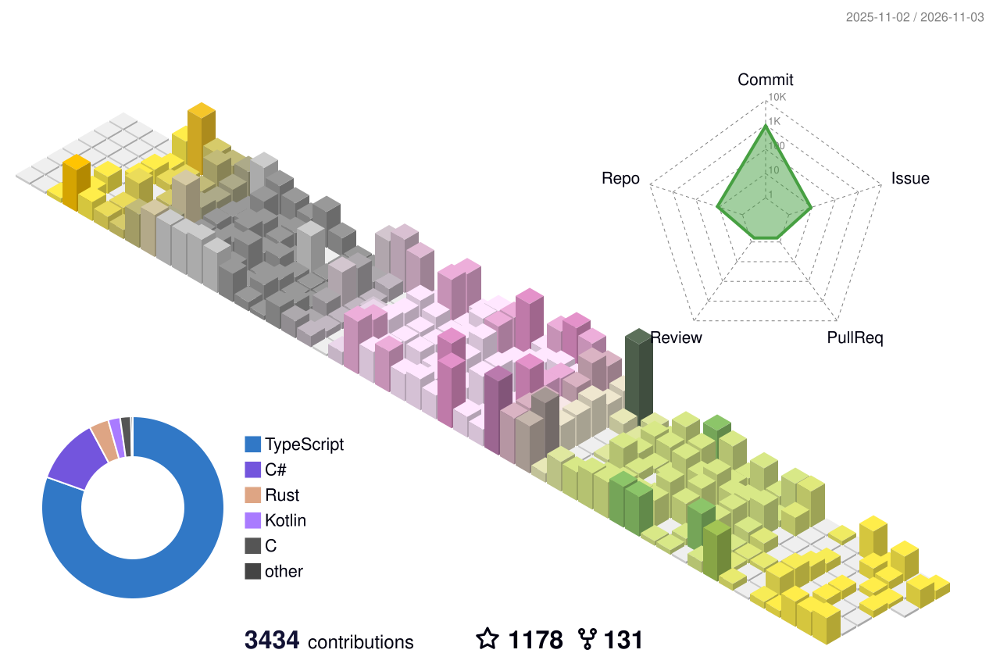

# Hi, I'm Cloris 👋

**📱 Android · HarmonyOS · 🦀 Rust · 🛠️ 跨平台桌面应用 · ✍️ Rust学习日记**

喜欢用代码做一些自己用得上的工具，也在公众号「Rust学习日记」分享 Rust 实践课程和最新消息。

## Open Source Projects

<!-- 按 2026-11-01 查询的 Star 数降序排列；同数时保留指定顺序。 -->

- 💬 **[gpt-aggregated-edition](https://github.com/1595901624/gpt-aggregated-edition)** (⭐ 713) — AI 对话平台聚合工具，支持自定义平台 / An AI chat platform aggregator with custom platform support.
- 🧰 **[TroveKit](https://github.com/1595901624/TroveKit)** (⭐ 118) — 轻量、离线、跨平台工具箱 / A lightweight, offline, cross-platform toolbox.
- 🦀 **[StudyRust](https://github.com/1595901624/StudyRust)** (⭐ 28) — 公众号「Rust学习日记」配套源码 / Code examples for my Rust learning journal.
- 🔌 **[RustJson](https://github.com/1595901624/RustJson)** (⭐ 5) — JSON 转 Rust 结构体的 JetBrains 插件 / A JetBrains plugin that converts JSON to Rust structs.
- 🌊 **[Flux](https://github.com/1595901624/flux)** (⭐ 3) — 基于 mihomo 和 WinUI 3 的轻量 Windows 代理客户端 / A lightweight Windows proxy client built with mihomo and WinUI 3.
- ✍️ **[文染 WenRender](https://github.com/1595901624/WenRender)** (⭐ 1) — 面向微信公众号写作的桌面 Markdown 编辑器 / A desktop Markdown editor for WeChat Official Account writing.
- 🔍 **[hark](https://github.com/1595901624/hark)** (⭐ 1) — 轻量 Ark 字节码反编译工具 / A lightweight Ark bytecode decompiler.

## Contributions

- 📚 **[FuchsiaOS-docs-zh_CN](https://github.com/FuchsiaOS/FuchsiaOS-docs-zh_CN)** (⭐ 925) — 参与 Fuchsia OS 简体中文文档项目 / Contributed to the Simplified Chinese documentation for Fuchsia OS.

## GitHub Stats

